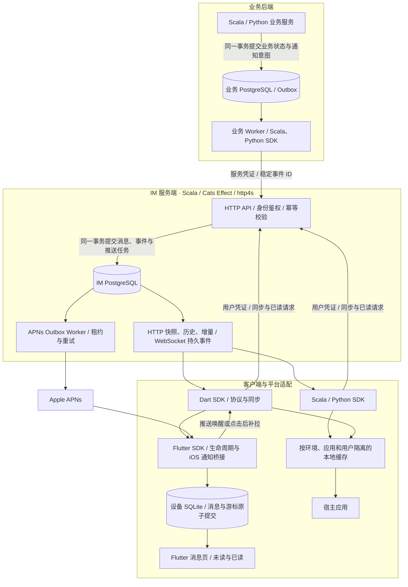

# Polyglot IM

**多语言、跨平台的即时消息基础设施。** Polyglot 表示多语言，IM 表示即时消息。

面向 Scala、Flutter / Dart 与 Python 的跨平台 IM 服务和 SDK，提供 App 业务通知、可靠同步、本地缓存与 iOS 推送适配。使用 Monorepo 管理协议与实现，以 **just** 统一开发、构建和发布入口。

## 系统架构



后端 PostgreSQL 的连接与连接池可配置；业务 Outbox 与业务状态处于同一事务，IM 消息、同步事件与推送任务在服务端原子提交。客户端持久化消息与游标后更新视图，APNs 仅触发提醒与补拉。详细流程见[系统架构](docs/architecture.md)。

## 子项目

| 子项目 | 说明 |
| --- | --- |
| [Scala SDK](jvm/scala-sdk/README.md) | 通知发送、同步客户端和业务事务 Outbox |
| [Scala Server](jvm/scala-server/README.md) | PostgreSQL 持久化通知服务、HTTP/WS 和 APNs |
| [Dart SDK](dart-sdk/README.md) | 纯 Dart 协议、HTTP/WS 与同步 |
| [Flutter SDK](flutter-sdk/README.md) | SQLite、消息页、生命周期与 iOS APNs |
| [Python SDK](python-sdk/README.md) | 异步发送、同步、缓存和业务 Outbox |
| [Benchmark](benchmark/README.md) | 并发吞吐、延迟和原始测量结果 |
| [iOS 示例](examples/flutter_app/README.md) | Flutter 消息中心接入示例 |

## Flutter App 接入入口

Flutter App 只依赖 `polyglot_im_flutter_sdk`，该包会引入并导出 `polyglot_im_dart_sdk` 的公共能力。Dart 核心保持独立，供纯 Dart 工程复用；生命周期、SQLite 与 iOS APNs 由 Flutter 层适配。用法与能力边界见[Flutter 集成文档](docs/sdk/flutter.md)。

## 环境

| 工具 | 基线 |
| --- | --- |
| just | 1.40.0（CI 固定） |
| JDK | 17+（CI 使用 17） |
| sbt / Scala | 1.10.7 / 3.6.3，由项目配置管理 |
| Flutter / Dart | 3.44.6 / 3.12.2（CI 固定 Flutter） |
| Python / uv | Python 3.11+ / uv 0.11.32（CI 固定） |

服务端与 Python 业务 Outbox 统一使用可配置的 PostgreSQL；设备离线缓存使用本地 SQLite。服务端连接、连接池及 Python DSN 配置见[开发与配置](docs/development.md)。不要求 Redis。APNs 可显式关闭。演示服务使用仅测试依赖中的临时 PostgreSQL，无需 Docker。

```sh
git clone git@github.com:bitlap/polyglot-im.git
cd polyglot-im
just setup
just check
just package
```

如果系统默认 Java 低于 17，请先切换 JDK。macOS 可按需通过 Homebrew 安装 just：`brew install just`。

## 启动与演示

```sh
just demo-server          # 终端一：随机凭证、临时真实 PostgreSQL，随机本机端口
just test-live            # 终端二：Python / Dart 实际 HTTP/WS 收发、幂等与已读
just example-ios          # iOS 示例，读取仅用户身份的本地临时配置
```

演示数据库退出后删除，凭证写入忽略目录 `.local-demo`；每次启动使用随机端口和新测试密钥，避免客户端将旧数据库游标复用于新演示环境。不能用于生产部署。

正式服务先创建 PostgreSQL 数据库，按 [环境模板](config/.env.example) 提供连接及三个独立随机签名密钥，然后 `just run-server`。应用只读环境变量，不自动载入 YAML/.env。存活探针 `/health/live`，数据库就绪 `/health/ready`。详见[配置](docs/development.md)、[架构](docs/architecture.md)及[业务接入](docs/integration.md)。

## 常用命令

| 命令 | 内容 |
| --- | --- |
| `just` | 列出命令 |
| `just setup` | 按锁文件安装依赖 |
| `just set-version 0.1.0` | 批量统一所有子项目版本并刷新锁文件 |
| `just check-versions` | 检查统一版本、锁文件和版本记录 |
| `just fmt` | 格式化三种语言与构建配置 |
| `just lint` / `just test` | 静态检查 / 全部测试 |
| `just check` | 文档、协议、风格与测试检查 |
| `just build` / `just package` | Scala JAR、Python 包、Dart/Flutter 源码包 |
| `just test-scala` / `just test-python` | 单独测试 Scala / Python |
| `just test-dart` / `just test-flutter` | 单独测试 Dart / Flutter |
| `just benchmark` / `just benchmark-smoke` | 真实 PostgreSQL 并发/延迟压测 / CI 冒烟 |
| `just test-benchmark` | 分位数、吞吐聚合与压测配置测试 |
| `just publish-scala` / `just publish-python` / `just publish-dart` | 发布保护入口 |

构建产物与发布配置见[构建与发布](docs/building.md)。

## 文档

- [文档目录](docs/README.md)：完整导航。
- [统一版本](VERSION) / [变更记录](changelog/README.md)：根目录集中管理，各模块按版本号存档。
- [技术设计](docs/design.md)：产品边界、模型、可靠性和演进。
- [系统架构](docs/architecture.md)：模块职责、同步流程、存储与部署。
- [异步与可插拔设计](docs/extensibility.md)：Cats/Cats Effect、Python 异步适配、资源所有权及模块命名。
- [功能矩阵](docs/features.md)：消息功能与接口能力。
- [协议与接口](docs/protocol.md)：消息、事件、错误码和实际 API。
- [SDK 集成](docs/sdk/README.md)：Scala、Flutter、Python 的用法及可运行例子。
- [开发与配置](docs/development.md) / [构建与发布](docs/building.md)。
- [并发与延迟基准](benchmark/README.md)：测试口径、复现命令与实测结果。
- [验证记录](docs/verification.md)：测试与构建记录。

## 许可证

本项目采用 [Apache License 2.0](LICENSE)。完整许可条款见 [LICENSE](LICENSE)，版权声明见 [NOTICE](NOTICE)。

```text
Copyright 2026 bitlap contributors.

Licensed under the Apache License, Version 2.0 (the "License");
you may not use this file except in compliance with the License.
You may obtain a copy of the License at

    http://www.apache.org/licenses/LICENSE-2.0

Unless required by applicable law or agreed to in writing, software
distributed under the License is distributed on an "AS IS" BASIS,
WITHOUT WARRANTIES OR CONDITIONS OF ANY KIND, either express or implied.
See the License for the specific language governing permissions and
limitations under the License.
```
