# Polyglot IM

**多语言、跨平台的即时消息基础设施。** Polyglot 表示多语言，IM 表示即时消息。

面向 Scala、Flutter / Dart 与 Python 的跨平台 IM 服务和 SDK，提供文字与表情单聊、App 业务通知、可靠同步、本地缓存与 iOS 推送适配。使用 Monorepo 管理协议与实现，以 **just** 统一开发、构建和发布入口。

## 系统架构



[Mermaid 源码](docs/diagrams/system-overview.mmd)

| 通信双方 | 发送方向 | 返回方向 |
| --- | --- | --- |
| 业务后端 ⇄ IM | 业务通知 | 事务提交确认 |
| 用户 A / B ⇄ IM | 发送、回复、补拉、ack、已读 | 提交确认、消息事件、已读回执 |
| 用户 A ⇄ 业务后端 | 业务操作 | 业务结果 |
| IM ⇄ Apple APNs | 推送请求 | 接受响应 |
| Apple APNs → 用户 B | 后台提醒，SDK 再向 IM 补拉 | 单向提醒，无用户送达或已读确认 |

实例共享 PostgreSQL 主库、应用身份与签名配置，消息按接收身份路由；连接可落在任意实例，提交后唤醒持有接收方连接的实例，离线后按游标补拉。业务状态与业务 Outbox 同事务提交，IM 消息、事件及推送任务也原子提交，APNs 仅负责提醒。

蓝色大框表示独立系统，橙色大框表示独立用户；系统位于上排，用户位于下排。直角折线统一走线，实线连接系统，橙色虚线连接用户与系统，往返通道分开绘制，连线首尾均垂直于矩形边框，通信内容见图下表格，分别体现发送与返回、事件与确认。系统订阅扩展单独见[系统间流程](docs/architecture.md#系统之间发送消息)。文字与表情单聊、业务通知、可靠同步与 APNs 已提供实现。用户互动通知由业务后端验证操作后发送给接收用户。单聊集成见[文字与表情](docs/direct-chat.md)，图片暂不支持。详细流程见[系统架构](docs/architecture.md)与[多实例部署及一致性](docs/distributed.md)。

## 子项目

| 子项目 | 说明 |
| --- | --- |
| [Scala SDK](scala-sdk/README.md) | 单聊、通知发送、同步客户端和业务事务 Outbox |
| [Scala Server](scala-server/README.md) | PostgreSQL 单聊与通知服务、HTTP/WS 和 APNs |
| [Dart SDK](dart-sdk/README.md) | 纯 Dart 协议、HTTP/WS 与同步 |
| [Flutter SDK](flutter-sdk/README.md) | SQLite、通知页、单聊页、生命周期与 iOS APNs |
| [Python SDK](python-sdk/README.md) | 异步发送、同步、缓存和业务 Outbox |
| [Benchmark](benchmark/README.md) | 并发吞吐、延迟和原始测量结果 |
| [iOS 示例](examples/flutter-sdk/README.md) | Flutter 消息中心接入示例 |

## Flutter App 接入入口

Flutter App 只依赖 `polyglot_im_flutter_sdk`，该包会引入并导出 `polyglot_im_dart_sdk` 的公共能力。Dart 核心保持独立，供纯 Dart 工程复用；生命周期、SQLite 与 iOS APNs 由 Flutter 层适配。用法与能力边界见[Flutter 集成文档](docs/sdk/flutter.md)。

## 环境

| 工具 | 基线 |
| --- | --- |
| just | 1.40.0（CI 固定） |
| JDK | 17+（CI 使用 17） |
| sbt / Scala | 1.10.7 / 3.6.3，由项目配置管理 |
| Flutter / Dart | 3.44.6 / 3.12.2（CI 固定 Flutter） |
| Python / uv | Python 3.11+ / uv 0.11.32（CI 固定） |

服务端与 Python 业务 Outbox 统一使用可配置的 PostgreSQL；设备离线缓存使用本地 SQLite。服务端连接、连接池及 Python DSN 配置见[开发与配置](docs/development.md)。不要求 Redis。APNs 可显式关闭。演示服务使用仅测试依赖中的临时 PostgreSQL，无需 Docker。

```sh
git clone git@github.com:bitlap/polyglot-im.git
cd polyglot-im
just setup
just check
just package
```

如果系统默认 Java 低于 17，请先切换 JDK。macOS 可按需通过 Homebrew 安装 just：`brew install just`。

## 启动与演示

```sh
just demo-server          # 终端一：随机凭证、临时真实 PostgreSQL，随机本机端口
just test-live            # 终端二：Python / Dart 实际 HTTP/WS 收发、幂等与已读
just example-ios          # iOS 示例，读取仅用户身份的本地临时配置
```

演示数据库退出后删除，凭证写入忽略目录 `.local-demo`；每次启动使用随机端口和新测试密钥，避免客户端将旧数据库游标复用于新演示环境。不能用于生产部署。

正式服务使用 PostgreSQL 的 `snapflow` 数据库，复制 [HOCON 配置模板](config/server.example.conf) 为 `config/server.local.conf`，填写连接及三个独立随机签名密钥，然后执行 `just run-server --config "$PWD/config/server.local.conf"`。默认读取 classpath 的 `application.conf`，支持环境变量覆盖。存活探针 `/health/live`，数据库就绪 `/health/ready`。详见[配置](docs/development.md)、[架构](docs/architecture.md)及[业务接入](docs/integration.md)。

## 常用命令

| 命令 | 内容 |
| --- | --- |
| `just` | 列出命令 |
| `just setup` | 按锁文件安装依赖 |
| `just set-version 0.1.0` | 批量统一所有子项目版本并刷新锁文件 |
| `just check-versions` | 检查统一版本、锁文件和版本记录 |
| `just fmt` | 格式化三种语言与构建配置 |
| `just lint` / `just test` | 静态检查 / 全部测试 |
| `just check` | 文档、协议、风格与测试检查 |
| `just build` / `just package` | Scala JAR、Python 包、Dart/Flutter 源码包 |
| `just test-scala` / `just test-python` | 单独测试 Scala / Python |
| `just test-dart` / `just test-flutter` | 单独测试 Dart / Flutter |
| `just benchmark` / `just benchmark-smoke` | 真实 PostgreSQL 并发/延迟压测 / CI 冒烟 |
| `just test-benchmark` | 分位数、吞吐聚合与压测配置测试 |
| `just publish-scala` / `just publish-python` / `just publish-dart` | 发布保护入口 |

构建产物与发布配置见[构建与发布](docs/building.md)。

## 文档

- [可运行示例](examples/README.md)：各子项目的独立使用示例。
- [文档目录](docs/README.md)：完整导航。
- [统一版本](VERSION) / [变更记录](changelog/README.md)：根目录集中管理，每个版本一个文件，汇总所有模块变化。
- [技术设计](docs/design.md)：产品边界、模型、可靠性和演进。
- [系统架构](docs/architecture.md)：模块职责、同步流程、存储与部署。
- [异步与可插拔设计](docs/extensibility.md)：Cats/Cats Effect、Python 异步适配、资源所有权及模块命名。
- [功能矩阵](docs/features.md)：消息功能与接口能力。
- [协议与接口](docs/protocol.md)：消息、事件、错误码和实际 API。
- [SDK 集成](docs/sdk/README.md)：Scala、Flutter、Python 的用法及可运行例子。
- [多实例部署、一致性与可靠性](docs/distributed.md)。
- [开发与配置](docs/development.md) / [构建与发布](docs/building.md)。
- [并发与延迟基准](benchmark/README.md)：测试口径、复现命令与实测结果。
- [验证记录](docs/verification.md)：测试与构建记录。
