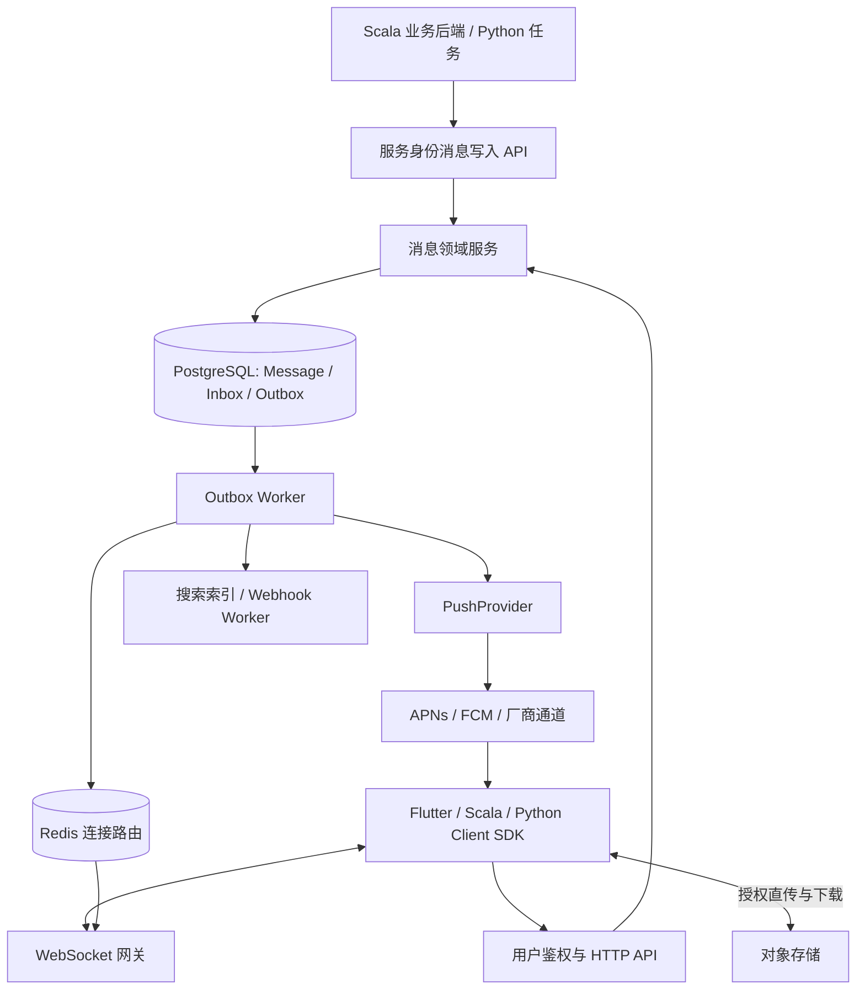
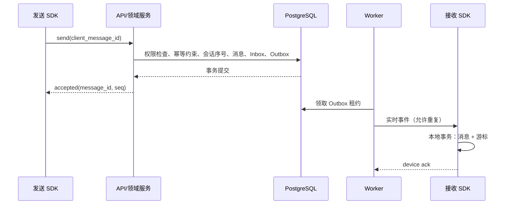

# 系统架构

## 目标架构与当前实现

下图是目标架构。当前提供消息模型、生命周期适配、可插拔传输基础和 Cats Effect/http4s 健康检查入口；数据库、Redis、WebSocket、Worker、推送与搜索均尚未接入。

## 模块职责

| 模块 | 责任 | 不承担的责任 |
| --- | --- | --- |
| AuthAdapter | 用户令牌交换、应用与角色映射、短期连接票据 | 业务账号注册登录 |
| ConversationService | 会话、成员、角色与可见范围 | 内容推荐 |
| MessageService | 发送、修改、撤回、幂等及序号 | 长连接存活维护 |
| SyncService | 用户事件流、带水位快照、游标校验 | 靠在线状态推断已读 |
| Gateway | 认证连接、心跳、背压、事件下发 | 唯一保存消息副本 |
| DeliveryWorker | Outbox 重试、路由、推送决策 | 把通道成功视作用户接收 |
| MediaService | 上传授权、扫描回调、下载权限 | 经由消息网关传大文件 |
| WebhookWorker | 签名回调、重试、死信与人工重放 | 阻塞发送事务 |
| SDK Core | 同步状态机、持久化、去重、发送队列 | 决定页面导航与业务权限 |
| PlatformAdapter | 生命周期、设备 token、系统通知点击 | 修改消息可靠性语义 |

代码先按领域模块组织在 Scala 单体中；外部服务通过接口注入。当前 HTTP 服务已采用 Cats Effect IOApp/Resource、http4s Ember 与 Circe；Scala SDK 提供效果多态的 HttpTransport[F]/TokenProvider[F]，Python 提供异步 Protocol 与可选 HTTPX 实现。存储阶段再接 Doobie 等适配器。组合与资源所有权见[异步与可插拔设计](extensibility.md)。

## 数据模型与约束

| 表（规划） | 关键字段与约束 |
| --- | --- |
| application / identity | 所有资源归属 app；映射业务用户与服务身份 |
| conversation | type、版本、生命周期；单聊成员规范化唯一键 |
| conversation_member | role、state、joined_seq、left_seq、last_read_seq；成员唯一 |
| message | app、会话、seq、作者、幂等键、type、payload、revision；会话 seq 唯一 |
| message_mutation | 编辑、撤回审计；敏感正文按保留策略处理 |
| user_inbox_event | 用户有序事件与提交内水位；按用户游标索引 |
| user_conversation_state | 隐藏截止位、归档、置顶、免打扰及未读计数 |
| device / device_cursor | 设备会话、token 状态、独立确认位置 |
| attachment | 所有者、扫描状态、资源身份和保留策略 |
| outbox | 重试时间、租约、投递键、失败原因 |
| webhook_delivery | 订阅、签名版本、尝试次数及死信 |

所有业务表都必须按应用作用域查询；ID 不可预测不能代替权限校验。媒体和用户数据不放 Redis 作为唯一副本。数据库迁移脚本尚未生成，不能直接将此表格当作部署 Schema。

## 写入事务

权限与写入应在一致事务边界中验证，避免退群/禁言与发消息竞态。并发分配会话序号可使用会话水位行锁；同事务内多接收者水位按稳定顺序锁定，防止死锁。

大群不直接对所有成员同步写 Inbox。先明确群规模上限；达到阈值后采用群共享日志与每用户水位的混合扇出，需要另外设计合并游标、权限截断和未读计算。群功能在 M4 才启用，届时先支持经过压测的小中型群；M1/M2 不为群扇出引入额外架构。

## 重连与快照

1. 用户鉴权交换连接票据，票据短期有效且绑定应用、用户和设备。
2. 网关注册订阅并缓冲事件，取得提交稳定水位 H。
3. 客户端从旧游标补拉至 H，将事件与游标原子落盘。
4. 排序、去重并应用缓冲事件，进入实时状态。
5. 游标过期时获取一致快照及水位，再执行上述追增量过程。

客户端缓冲和网关队列均有上限。超过上限返回可恢复错误并断连，客户端保留游标重新补拉。HTTP 超时、连接重试与业务重复提交必须分开处理。

## 多节点路由

网关实例无状态持久化，设备连接持有租约；Redis 记录实例与设备映射。Redis Pub/Sub 可以用于加速通知，但丢失后必须从数据库事件流恢复。Worker 在租约超时后允许其他实例接管，外部发送使用幂等投递键。

认证撤销、用户封禁和设备退出需要主动断连并由定期认证校验兜底。网关重启不影响历史消息；SDK 使用已有游标重连。

## 平台适配

| 平台 | 实时能力 | 本地持久化目标 | 系统提醒 |
| --- | --- | --- | --- |
| Flutter iOS | 前台 WSS | SQLite + 安全凭证存储 | APNs |
| Flutter Android | 前台 WSS | SQLite + 安全凭证存储 | FCM / 厂商通道 |
| Flutter Web | 页面存活时 WSS | IndexedDB，处理多标签协作 | Web Push，可选 |
| Flutter 桌面 | 应用运行时 WSS | SQLite | 平台能力独立验证 |
| Scala JVM | WSS / HTTP | 可插拔持久化 | 服务端一般无需系统推送 |
| Python | asyncio WSS / HTTP | 可插拔持久化 | 服务端一般无需系统推送 |

当前 Dart 核心没有 dart:io 依赖，可作为 Web 适配基础；浏览器、桌面实际运行与系统推送尚未验证。Flutter 单元测试只验证生命周期转发，不等于平台集成完成。

## 部署与演进

M0 为本机开发服务。M1 接入 PostgreSQL 后交付 App 通知、列表、已读/未读、本地缓存和可靠补拉，M2 增加实时与后台推送；M3 提供单聊，M4 再交付群消息、撤回等高级能力。完整 App 提醒版本不依赖 M3/M4，见[实施路线](roadmap.md)。生产环境使用反向代理终止 TLS、限制请求体、配置 WS 空闲超时与优雅排空。只读存活探针与依赖就绪探针分开，当前 readiness=503 是明确的未就绪信号。

未来将 Gateway 与 Worker 分离部署时沿用协议和存储契约。是否引入 Kafka、独立搜索引擎或跨区域副本由负载与故障恢复需求决定，不在初始化阶段预先承诺。
