# 系统架构

## 部署

Scala 服务使用 Cats Effect / http4s，PostgreSQL 保存全部可靠消息事实；客户端可以仅用 HTTP，也可增加 WS。iOS APNs 是可选适配器，密钥只保存在服务端。实现不要求 Redis。后端业务存储统一 PostgreSQL，连接与连接池参数由宿主配置；设备离线缓存使用本地 SQLite，移动端不持有数据库凭证。

系统总览统一见 [README 系统架构](../README.md#系统架构)。

总览中每个系统和用户分别分框，系统在上、用户在下；系统间使用实线，用户与系统使用橙色虚线。Apple APNs 只向用户提醒，其接受响应返回 IM，不作为用户已读或送达确认。

IM 框内的实例 A、B 可互换，API、WS、Worker 是各实例内的组件；接收者连接到哪个实例，就由哪个实例下发。API、鉴权、全局限流、存储与推送任务共享可靠状态。数据库主备由部署环境配置，可靠读取走写主库。

## 消息参与方与路由

| 发送方 → 接收方 | 发送与接收路径 | 接口边界 |
| --- | --- | --- |
| 用户 A → 用户 B：互动通知 | A 操作业务后端，后端验证后用服务身份通知 B，B 通过用户 Client 同步 | 已实现的评论、回复、点赞等业务通知；通知作者是业务系统 |
| 用户 A → 用户 B：直接单聊 | A 的用户身份验证、会话成员校验、会话事务、B 的连接投递 | 已实现文字与 Unicode 表情，发送人从用户凭证取得；不开放用户调用服务通知接口 |
| 系统 A → 用户 B | A 的业务事务 Outbox、服务 Token、通知 API、B 的收件箱及 APNs | 已实现；服务 Token 约束应用、接收用户和消息类型 |

路由身份必须包含应用命名空间与接收方类型。已有通知接口的 recipient_id 表示接收用户；Service Token 用于受限的通知发送，用户 Token 用于本人同步、设备和阅读操作。

## 用户之间发送消息

用户互动通知已通过业务后端接入：例如用户 A 评论用户 B 的作品，后端校验评论及可见性，在业务事务写入通知意图，再向 IM 发送 comment.created。B 的各设备按接收用户路由恢复消息；通知中的业务关联数据可用于展示和导航，不会赋予客户端伪造系统作者的权限。

下面是已实现的文字与表情单聊路由。会话成员权限、用户发送入口和会话维度序号独立于通知收件箱，完整接口见[单聊集成](direct-chat.md)。图片与 COS 接入暂不支持。

| 通信双方 | 用户 → IM | IM → 用户 |
| --- | --- | --- |
| 用户 A ⇄ IM | 发送文字 / 表情、落盘 ack、实际已读 | 提交确认、消息与已读事件 |
| 用户 B ⇄ IM | 回复文字 / 表情、落盘 ack、实际已读 | 提交确认、消息与已读事件 |

## 多实例提交与投递

1. 网关将发送请求分发至任意实例；实例完成身份、范围与集群配额校验。
2. 消息、事件和推送 Outbox 在 PostgreSQL 同一事务提交；提交成功后返回发送确认。
3. NOTIFY 将接收身份路由散列广播给监听实例；每个实例只唤醒自己的匹配连接，从持久流读取内容。
4. 接收者落在另一实例、临时离线或监听断线，都按同一签名游标继续补拉；5 秒协调检查覆盖遗漏唤醒。
5. 任意 Worker 可按数据库租约领取 APNs 任务；领取标识隔离过期 Worker 的回写，实例退出后由其他实例接管。

这条提交和恢复链路已用于业务通知和文字单聊。部署配置、数据库主备与故障保证见[多实例方案](distributed.md)。

消息的事务范围、幂等键与排序规则见[一致性与顺序](delivery.md#一致性与顺序)，业务端发送意图的落库方式见[业务事务 Outbox](integration.md#业务事务-outbox)。

## 数据表

| 表 | 用途 |
| --- | --- |
| snap_flow.im_schema | 当前表结构初始化标记 |
| snap_flow.im_user_state | 每用户消息/事件/阅读/留存水位 |
| snap_flow.im_message | 通知内容、顺序和生产者幂等指纹 |
| snap_flow.im_event | 持久增量事件流 |
| snap_flow.im_device | 设备 token、静音、预览、会话及接收确认 |
| snap_flow.im_ticket | 哈希保存的一次性短期连接票据 |
| snap_flow.im_outbox | APNs 领取租约、领取标识、重试、死信 |
| snap_flow.im_rate_limit | 跨实例共享的应用/角色/身份配额 |
| snap_flow.im_producer_outbox | 可选 Client 业务数据库适配器；位于宿主业务数据库 |

初始化通过 PostgreSQL advisory lock 串行执行 [schema.sql](../scala-server/src/main/resources/db/schema.sql)，直接创建当前表结构；重复启动不重复建表。全部 Server 表显式使用 `snap_flow.im_xxx`，不依赖 `search_path`，不提供旧表升级或历史数据迁移。生产启动时缺少数据库/签名配置直接失败。就绪探针检查数据库和 schema；存活探针只说明进程响应。

## 读取和同步

HTTP 快照、增量与 WebSocket 均通过持久事件流读取消息。游标由 HMAC 绑定应用和用户；WS 使用 30 秒一次性票据，每 20 秒 Ping，到身份期限终止，输出受 FS2 背压约束。接口字段与分页参数见[协议](protocol.md)。

快照范围、缓存提交、ack、已读与重建流程见[断线、ack 与离线恢复](delivery.md#断线ack-与离线恢复)；跨实例唤醒与 Worker 调度参数见[多实例部署](distributed.md)，APNs 配置与任务处置见[安全与运维](operations.md#apns)。

## 扩展边界

核心端口允许替换认证、HTTP、WebSocket、本地存储与 PushProvider，Scala 使用 F[_]/Resource，Python 使用异步 Protocol/资源工厂。Flutter 封装持久化、平台生命周期和通知桥接，Dart 核心不导入 Flutter。文字单聊沿用消息信封和账户事件流；当前没有媒体、群聊或撤回接口。

单聊使用 snap_flow.im_direct_conversation 和 snap_flow.im_direct_message；事务锁顺序、未读计数与快照边界见[单聊实现](direct-chat.md)。

HTTP 公共前缀 `/api/v1/im` 在 Server.apiRoutes 中通过 http4s Router 统一挂载，业务路由只匹配相对路径。统一响应由 ApiResponse 构建，成功为 code/message/data，错误另带 error_code、request_id 和 retryable；WS 文本帧保留独立同步协议。
