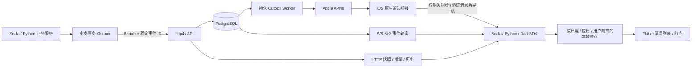

# 系统架构

## 部署

Scala 服务使用 Cats Effect / http4s，PostgreSQL 保存全部可靠消息事实；客户端可以仅用 HTTP，也可增加 WS。iOS APNs 是可选适配器，密钥只保存在服务端。实现不要求 Redis。后端业务存储统一 PostgreSQL，连接与连接池参数由宿主配置；设备离线缓存使用本地 SQLite，移动端不持有数据库凭证。

## 写入与顺序

业务宿主把业务状态和发送意图写入自己的同一事务，再由 Outbox Worker 调用通知 API。IM 服务以 app_id、sender_id、client_message_id 做幂等；对幂等键加事务 advisory lock，并对接收用户状态行加 FOR UPDATE。相同键且相同规范化 payload 返回原消息，改变目标或内容返回 409。

每个用户一个系统通知会话；message_seq 只给新消息递增，event cursor 对 message.created 和 read.updated 都递增。消息、事件、用户水位及设备 APNs Outbox 在同一事务提交，因此客户端看不到指向未提交消息的游标。不同用户互不占用同一顺序锁；多实例共享 PostgreSQL 即可保持正确性。

## 数据表

| 表 | 用途 |
| --- | --- |
| im_schema_version | 迁移版本 |
| im_user_state | 每用户消息/事件/阅读/留存水位 |
| im_message | 通知内容、顺序和生产者幂等指纹 |
| im_event | 持久增量事件流 |
| im_device | 设备 token、静音、预览、会话及接收确认 |
| im_ticket | 哈希保存的一次性短期连接票据 |
| im_outbox | APNs 领取租约、重试、死信 |
| im_producer_outbox | 可选 SDK 业务数据库适配器；位于宿主业务数据库 |

迁移使用 PostgreSQL advisory lock；V1.sql 位于 Scala server resources。生产启动时缺少数据库/签名配置直接失败。就绪探针检查数据库和 schema；存活探针只说明进程响应。

## 读取和同步

初次初始化获取快照：同一用户行锁内读取最近 100 条消息和高水位；更旧历史通过 before_seq 分页。增量按持久 cursor 升序返回，has_more 时继续。游标通过 HMAC 绑定应用和用户，不能跨账户复用。客户端将消息与游标原子落盘，再发布本地视图和 ack。消息重复时按 ID 合并，旧事件页不会回退进度，已读与消息水位保持单调。

留存清理后返回 410 RESET_REQUIRED，SDK 获取新快照替换缓存再继续；旧历史仍可分页。消息历史本身的产品保留时长需要宿主按业务法规明确配置，不能直接把删增量事件当作删除消息。

WS 使用 30 秒一次性票据，在数据库原子消费；握手后从持久游标读取，避免连接期间的新消息间隙。每 500ms 查询一批最多 25 个事件，输出受 FS2 背压约束；每 20 秒 Ping，到身份期限终止。客户端先 HTTP 补拉，再建立 WS，断线指数退避，HTTP 轮询可独立兜底。接收 ack 仅表示已持久化，不提升用户阅读水位。

直接轮询数据库有可预测但不低的查询成本：连接数增长时必须实测容量。后续可用 Redis/消息总线唤醒轮询，但唤醒不成为唯一消息来源；遗漏唤醒仍从 PostgreSQL 追赶。未进行大规模容量承诺。

## 已读与 APNs

用户已读位置 max(old_read, requested_read)，不超过服务端消息高水位；unread = latest_seq - read_seq。全部已读以请求前捕获的位置为界，后来到达的通知保持未读。已读变化写事件流供多设备同步。

APNs Outbox 延迟 3 秒领取，允许前台已读抑制提醒。领取采用 SKIP LOCKED 和 60 秒租约；Worker 崩溃后重新领取，最大重试 10 次，指数退避后进入 dead。每次投递前重新检查 token、活跃会话、静音和已读，失效 token 条件解绑。APNs HTTP/2 请求采用 ES256 provider JWT，默认不显示敏感正文。APNs accepted 不写已读或用户送达状态。

## 扩展边界

核心端口允许替换认证、HTTP、WebSocket、本地存储与 PushProvider，Scala 使用 F[_]/Resource，Python 使用异步 Protocol/资源工厂。Flutter 封装持久化、平台生命周期和通知桥接，Dart 核心不导入 Flutter。P2 单聊、媒体与 P3 群聊/撤回沿用消息信封及事件流，没有暴露空实现接口。
