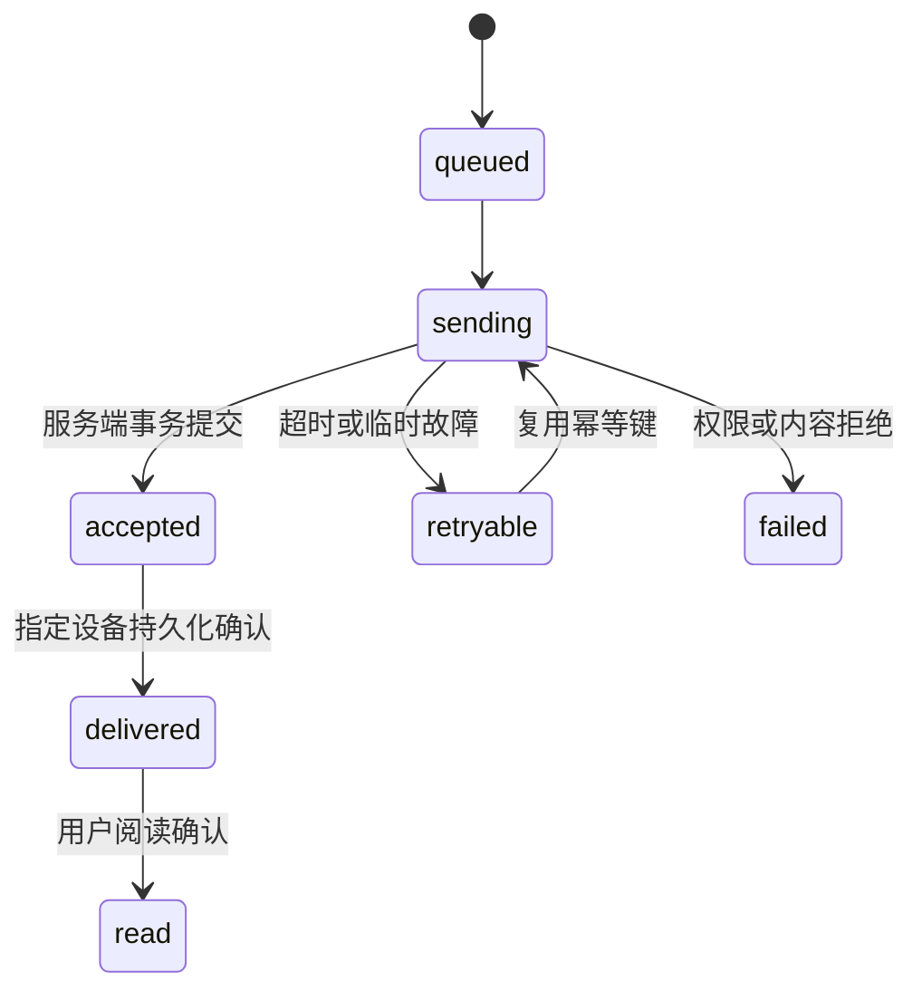

# 技术设计

## 目标

polyglot-im 将 App 现有分页通知升级为可独立复用的消息平台，支持 Scala、Dart / Flutter、Python。通知优先，领域模型同时为单聊和群聊预留完整语义。

所有规划能力及状态以[功能矩阵](features.md)为准。业务用户、好友关系与作品资源继续由接入业务管理，IM 不复制一套业务账号系统。

## App 优先的实施范围

先交付 P0/M1 的业务通知、列表、未读/已读、本地缓存、可靠补拉和账号隔离，再交付 P1/M2 的实时与后台提醒。P2/M3 才增加用户单聊和媒体发送，群消息、群管理与撤回统一后置到 P3/M4。M1 不要求实现完整聊天客户端；M1 + M2 构成 App 首个完整提醒版本。下文保留完整目标模型，预留字段和操作语义不等于要求提前实现所有表与路由。顺序以[实施路线](roadmap.md)为准。

## 异步与扩展约束

Scala 使用 Cats/Cats Effect，业务端口效果多态，IO 在组合根落地，Resource 管理资源。Python 使用 async/await 与 Protocol，HTTPX 为可选适配器，连接池由显式异步上下文管理。核心依赖接口，具体网络、存储、推送可替换；更换适配器不能降低事务、认证和取消释放语义。实现与阶段边界见[可插拔设计](extensibility.md)。

## 主要决策

| 决策 | 方案与原因 |
| --- | --- |
| 多语言复用 | 统一协议、错误、状态机与契约样例，各语言原生实现 |
| 仓库与构建 | Monorepo + just；底层保留 sbt、Dart/Flutter CLI、uv |
| 传输 | HTTPS 写入/查询与 WSS 实时事件，文件走对象存储 |
| 编码 | JSON v1；协议对象使用 snake_case，代码按语言惯例命名 |
| 存储 | PostgreSQL 持久化、租约隔离与提交后唤醒；不依赖 Redis |
| 消息投递 | 至少一次 + 服务端幂等约束 + 客户端去重 |
| 后台提醒 | 独立推送适配，不能依赖移动端后台长连接 |
| 数据一致性 | 消息、接收者事件和 Outbox 同事务；跨业务系统使用生产方 Outbox |
| 版本 | 子项目统一版本；协议主版本独立协商 |

初期为模块化单体，只有确实出现连接、吞吐或部署隔离需求时再拆分网关和 Worker。不以引入消息队列作为消息可靠性的前提。

## 领域模型

- `Tenant/App`：租户与应用边界；所有资源查询带应用作用域，禁止跨应用枚举。
- `User/Device`：业务映射用户与设备身份；服务身份单独授权。
- `Conversation`：`notification`、`direct`、`group` 三类会话。
- `Member`：角色、成员状态、加入时可见范围、退群截止位置、已读水位和偏好。
- `Message`：不可变身份、会话序号、类型和当前内容版本。
- `InboxEvent`：接收者可恢复的事件流，不仅包含新消息，还包含编辑、撤回、已读和成员变化。
- `Outbox`：事务内产生的待投递事件。
- `Attachment`：资源标识、媒体属性、扫描状态、权限与签名下载策略。

单聊唯一键由应用、规范化的两个成员身份和会话类型组成，服务端防止重复创建。通知会话不允许普通用户伪造系统发送者。群系统消息由服务端产生。

## 身份、顺序和版本

`message_id` 标识消息；`client_message_id` 标识一次发送意图，重试复用；`conversation_seq` 是会话内单调提交顺序；`sync_cursor` 是用户事件流的不可解释游标。四者不能混用。

序号与 ID 编码为字符串。创建时间使用 UTC RFC 3339，不依赖客户端时钟排序。消息编辑增加 `revision`，不重新分配原消息序号；事件流为该编辑分配新事件位置。

未知 `type` 按自定义消息安全回退；保留 payload，UI 展示“暂不支持的消息”。可选新字段允许忽略；主版本不匹配显式报错，不能静默解释。当前模型会忽略未知信封字段，业务必需字段须先纳入 Schema 与三端实现。

## 发送状态机

`accepted` 表示服务端持久化完成；`delivered` 按接收设备记录；`read` 按接收用户及会话记录。推送通道接受请求不能转换为 delivered/read。

幂等唯一键为 `(app_id, sender_id, client_message_id)`。同键不同内容返回冲突；同键同内容返回原结果。去重记录需覆盖客户端最大重试窗口，过期策略必须通过协议公开；不能仅依赖进程缓存。

## 同步与离线

实时事件和 HTTP 补拉来自同一份持久化 InboxEvent。SDK 仅在本地数据与同步水位同事务提交后确认事件；崩溃恢复允许重复，不能跳过未落盘事件。

握手时先建立订阅/缓冲，再得到稳定水位 H，补齐到 H，之后按顺序应用缓冲与后续事件。用户游标必须反映提交顺序，不能简单使用 PostgreSQL sequence 的分配顺序：事务可能反向提交。初期可采用每用户水位行锁与提交内分配；提升吞吐时再采用有提交顺序保证的日志。

游标过期返回 `RESET_REQUIRED`，客户端获取带水位快照，再追增量。编辑、删除、撤回都需要保留足够长的事件或墓碑，避免离线设备恢复旧数据。

## 消息操作语义

- **撤回**：服务端校验作者、角色与时间窗；保留墓碑及审计，不等于物理删除。引用摘要随撤回隐藏敏感正文。
- **编辑**：校验作者及窗口，使用 `expected_revision` 防止覆盖；已读水位不后退。
- **删除**：本设备删除、用户全设备隐藏、管理员合规清除是三种不同操作；默认删除不能替其他用户删除消息。
- **清空会话**：记录用户可见截止水位，后续新消息仍可出现；单独配置是否重置未读与是否归档。
- **回复/引用**：校验原消息可见性；原消息撤回后显示占位。
- **转发**：创建新消息，过滤无权访问的资源及私密元数据；合并转发逐条做可见性检查。
- **回应**：按用户、消息、表情唯一，添加/移除幂等，聚合数量避免事件放大。
- **过期消息**：服务端控制 TTL，过期生成墓碑；本地按服务器校时辅助隐藏，无法保证已导出副本消失。

## 多端、未读与临时状态

每设备独立同步水位；同一用户的会话已读位置取服务端确认的最大值。未读数由明确计数规则维护：自己的消息、系统进度、撤回占位等不一定计数，不能简单做序号相减。

在线与输入状态是短期租约，不写入可靠消息流；定期刷新、超时失效、节流发送，禁止向无权用户泄露。草稿第一阶段只保存在本设备，跨设备草稿同步属于后续功能。

## 媒体、推送与搜索

附件采用上传授权、直传、服务端确认/扫描、消息引用的流程。未完成或被隔离资源不可发送，下载权限每次校验；临时 URL 不作为消息中永久身份。

移动推送遵循用户授权、免打扰、静音、通知隐私与平台限制。推送携带最小标识，进入 App 后补拉。任务进度允许合并，最终成功/失败进入持久通知。

搜索以服务端可见性过滤为前提，初期使用 PostgreSQL 可用索引和明确的中文分词方案；搜索索引异步更新时保留延迟指标。撤回、退出群和数据删除必须同步影响搜索结果。客户端本地搜索只覆盖已下载内容。

## 安全边界与非目标

传输加密、存储访问控制、审计及敏感数据最小化属于基础能力。端到端加密需要多设备密钥分发、备份恢复和搜索策略，不能用 TLS 宣称实现 E2EE。音视频通话需要独立信令、媒体服务和成本评估；消息 SDK 仅预留业务扩展入口。

功能完成标准、负载目标与实测证据分开记录，未压测前不承诺连接规模或吞吐数值。
