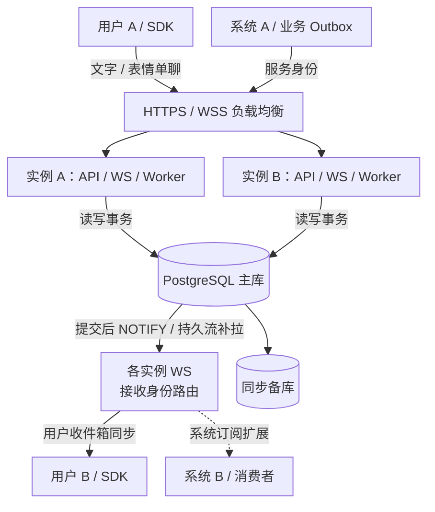

# 多实例、一致性与可靠性

## 部署模型

业务 API 与长连接接入可水平扩容。实例共享同一 PostgreSQL 写主库以及相同 app-id、issuer、三个签名密钥与协议版本。所有可靠读取也走主库；不将用户同步、票据或幂等查询路由到异步只读副本。单个 WS 连接由建立它的实例维护，其他实例通过数据库提交后的通知唤醒该实例；无需 sticky session 或全局内存在线用户表。



图中各实例 WS 表示接入实例内的投递组件。消息通过接收身份路由到持有连接的实例，写入实例与下发实例可不同。A 写入、B 下发是其中一种分配方式，连接重建可落在其他实例。“系统订阅扩展”表示尚未开放的接口；文字与表情单聊已实现，详见[单聊集成](direct-chat.md)。用户互动通知通过业务后端以服务身份发送，系统到用户的通知与用户收件箱同步已实现。用户间与系统间的完整流程、身份和消费确认边界见[系统架构](architecture.md)。

本地可在两个终端使用同一份 [HOCON 文件](../config/server.example.conf)：

```sh
POLYGLOT_IM_PORT=8090 just run-server --config "$PWD/config/server.local.conf"
POLYGLOT_IM_PORT=8091 just run-server --config "$PWD/config/server.local.conf"
```

[nginx.example.conf](../config/nginx.example.conf) 将 HTTP 与 Upgrade 转发到两个端口，提供连接复用、被动故障剔除和超时示例。生产需配置 HTTPS/WSS、readiness 主动检查、连接上限、FD、带宽与重连抖动策略；应用的 HTTP 请求门限不会限制已建立的 WS 连接总数。代理不能记录 Authorization、ticket 查询串或消息正文。不要开启非幂等请求的任意自动重试；发送消息通过稳定 client_message_id 重试。

## 一致性边界

| 状态 | 协调方式 | 保证 |
| --- | --- | --- |
| 发送幂等 | 跨实例 advisory transaction lock + 唯一约束 + 内容指纹 | 相同应用/发送者/幂等键只创建一次；更换目标或内容返回 409 |
| 用户消息、事件序号、已读 | 用户行锁，事务中分配序号并写入消息/事件/Outbox | 同一用户有提交顺序；已读只前进；不建立跨用户全局总序 |
| 快照和增量 | 主库 REPEATABLE READ 只读事务 | 同一响应的水位和数据来自同一数据库快照，不锁住用户写入行 |
| 设备和票据 | 用户锁、数据库唯一约束、原子 DELETE 消费 | 票据可由任一实例消费且仅成功一次，登出后不能重新签发 |
| APNs token 归属 | 应用级注册锁先于用户/设备锁 | 多用户同时注册同一 token 不破坏唯一约束，避免 token 交换的反向加锁死锁；仅低频注册走此锁 |
| 限流 | PostgreSQL 原子 UPSERT，数据库分钟窗口 | 同一应用/角色/主体的窗口配额跨实例共享，扩容不放大配额；数据库故障不降级放行 |
| 推送任务 | SKIP LOCKED + 数据库时钟租约 + 每次领取的随机标识 | 接管后旧 Worker 不能覆盖状态或清除设备 token；失败重试，预算耗尽进入 dead |

成功的发送响应发生在事务 commit 之后。若提交成功而响应丢失，客户端使用同一幂等键重试。幂等键和消息需要共同保留，删除后不再保证历史重试去重。收到 WS 帧、提交客户端缓存、设备 ack、APNs 接受和用户已读分别是不同事实。

固定窗口限流允许分钟边界的突发，且计数行会增加一次数据库写入；同一生产者大量并发请求会竞争这行。它优先提供准确的集群配额，不能宣称零协调成本。生产入口还需防护未认证请求及连接洪峰。更高容量可根据压测将配额交给统一网关，或专门设计保守额度预分配；不能把实例内计数冒充全局配额。

## 实时唤醒与恢复

消息/已读事件在同一事务执行 `pg_notify`，仅在提交后可见。载荷只含不可逆的账户路由散列，不含正文或 token。每实例使用一条独立、autocommit 的 LISTEN 连接，不占业务连接池；数据库地址必须支持会话级 LISTEN，不能经过 transaction pooling 的代理。

每个本地连接的唤醒队列容量为 1，重复提示合并；按游标从持久事件流连续追完分页，每页 25 个事件，避免积压在内存或生成超过 SDK 上限的帧。慢连接在当前页发送后继续追赶。监听断开会重连，LISTEN 成功后触发补拉；另有每连接 5 秒的协调检查，覆盖丢通知和重连窗口。通知不是消息存储，不把 NOTIFY 当作可靠队列。登出也发出唤醒，存量连接在下一次检查时失效，断线期间最长等待一个协调周期加查询/网络时间。

默认日志级别为 INFO，避免把每次连接池重置的 DEBUG 日志写入热路径；重复 ack 不改写相同水位，降低空闲连接的 WAL 写入。默认情况下，空闲连接的数据查询频率由每秒 2 次降为每 5 秒一次；还会有客户端心跳及 ack 流量。通知模式降低等待，不代表所有负载下都能达到某个固定延迟。广播开销随实例数增长，高吞吐场景需要监控通知队列、连接数和数据库写入瓶颈，再考虑按用户分片和分区事件总线。

## 推送接管与过载保护

Worker 每轮最多领取自身可并发执行数量的任务，批内并行，不预领多批等待。默认 parallelism=8，lease-duration=60 seconds，job-timeout=20 seconds，poll-interval=1 second；租约必须比任务超时至少长 5 秒。领取、到期判断、重试调度使用数据库时钟；失效 token 清理与任务完成均受领取标识保护；并行 APNs 的到达顺序不作为消息顺序，App 按持久流序号恢复。达到 10 次领取预算后进入 dead，包括不断崩溃的领取任务。

APNs 是至少一次尝试：请求被 Apple 接受后进程崩溃或响应丢失，重试仍可能再次提醒。领取隔离只保证数据库状态不被旧任务覆盖，不能撤销已发出的网络副作用；collapse-id 不是严格 exactly-once 承诺。App 仍以 message_id 去重并补拉可靠消息。

`server.max-in-flight` 默认 256，限制正在处理的 HTTP 请求，满载立即返回可重试 503，存活探针不被业务门限阻断。业务连接池、连接等待、statement-timeout（默认 15 秒）及 lock-timeout（默认 3 秒）共同限制排队。JDBC 默认连接超时 10 秒、socket 超时 30 秒，可在 JDBC URL 中覆盖驱动参数。失败后客户端应指数退避并增加抖动，不能无限立即重试。

每个实例至少预算 `database.pool-size + 1` 个数据库连接，额外一条用于 LISTEN；运维和其他业务还需预留连接。扩容不等于扩大主库连接预算。每分钟有界清理过期票据及旧限流记录，集群通过事务级选主避免同时清理；可靠消息、幂等记录和 Outbox 不自动删除。

## 数据库高可用

多个应用实例不会使单库自动变成高可用集群。生产需由托管 PostgreSQL 或受仲裁系统管理的主备方案负责同步复制、主库选举、旧主隔离、备份及恢复。不能让分区后的两端各自接受独立写入，再期望自动合并用户序号。

- 主库启用 `fsync=on`、`full_page_writes=on`，业务会话 `synchronous_commit=on`，并实际配置 `synchronous_standby_names`。仅设置 on 而没有同步备库，不能证明主机故障后零数据丢失。
- 主库地址通过可靠的主库服务端点暴露，JDBC 可用 `targetServerType=primary`；readiness 拒绝 recovery 副本。保持数据库节点时钟同步，签名密钥和 app-id 统一管理。
- 在同步仲裁不足或数据库网络分区时阻止成功写入，恢复后按稳定幂等键重试。同步复制会增加提交延迟；跨地域 RTT 不能通过换 HTTP 协议消除。
- RPO、RTO 和数据库切主后的已确认消息持久性，需要在真实主备环境执行断网、断电及恢复演练。本仓的进程故障测试不代替数据库 HA 验收，也不承诺跨地域多主。

V2 迁移新增推送领取标识及全局限流表。首次升级需先停掉旧版本 APNs Worker，再启动新版本；旧 Worker 不认识领取标识，不能与新 Worker 混跑后宣称租约隔离成立。多实例同时启动由数据库迁移锁串行协调，已应用的版本不重复执行 DDL。

## HTTP 是否足够

写入、历史和快照保留 HTTP JSON，实时下行使用 WSS。入口可通过 HTTP/2 复用客户端请求，网关到 http4s 的 HTTP/1.1 保持连接复用；这不意味着 Ember 已提供原生 HTTP/2 或 HTTP/3。gRPC/Protobuf 可降低部分编解码/传输成本，但不解决幂等、事务、热点用户排序和 Worker 接管。先测提交延迟、锁等待、WAL、CPU、连接池和尾延迟，再决定是否增加内部 gRPC 或批量入口，不能凭协议名字承诺容量。

## 验证与容量

- `just test-scala`：含两个独立连接池的并发迁移/去重/顺序/已读/票据/token/限流/租约接管测试，监听断线恢复和完全无监听时的补拉，以及 HTTP 门限与取消释放。
- `MultiProcessSuite` 启动两个真实 JVM：A 签发票据、B 建立 WS、A 写入唤醒 B，强制终止 A 后 B 幂等重试并继续收发。
- `just benchmark --instances 2`：同一 JVM 内两套独立生产组合根、连接池、监听连接与 HTTP 端口，HTTP 轮询分发，WS 建连和写入落在不同实例。它是共享机器与 JVM 的多实例功能/性能实验，不是跨机扩容或进程隔离的容量证明。

容量验收应明确在线设备数、峰值发送/s、热点分布、消息大小、到达 p99、错误率、负载持续时间、RPO/RTO。基准原始样本、口径和结果见 [benchmark](../benchmark/README.md)。

机制依据：[PostgreSQL NOTIFY](https://www.postgresql.org/docs/current/sql-notify.html)、[LISTEN 初始化竞态](https://www.postgresql.org/docs/current/sql-listen.html)、[事务隔离](https://www.postgresql.org/docs/current/transaction-iso.html)、[同步复制](https://www.postgresql.org/docs/current/warm-standby.html)、[HTTP/2](https://www.rfc-editor.org/rfc/rfc9113.html)。
