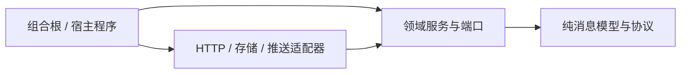

# 异步实现与可插拔架构

## 技术约定

Scala 基线为 Cats 2.12.0、Cats Effect 3.5.7、http4s 0.23.30。Python 核心只依赖标准库，HTTPX 通过 `[http]` 可选依赖接入。websockets 通过可选 [http] 依赖提供，SQLite 使用标准库线程适配，不把所有后端强加给只用消息模型的用户。

## 依赖方向

领域服务只依赖端口和纯模型，适配器实现端口，组合根负责选择实现、配置与生命周期。代码引用方向为适配器/服务 → 端口与模型。核心不得读取环境变量、创建全局线程池、静默分配 HTTP 客户端或使用单例连接。

实现 HTTP、认证、SocketConnector、LocalStore 与 PushProvider 端口，以及 PostgreSQL 事务仓储、业务 Outbox、APNs 适配与同步客户端。服务端 Store 的可靠写入是一个事务，不能为了插件数量把它拆成互相不一致的多次写入。

## Scala：效果多态与资源

- 纯消息模型和 Circe 编解码继续保持纯函数。
- 网络/存储/业务端口使用 `trait Xxx[F[_]]`，返回 `F[A]`；只使用必要的 Cats 约束，例如认证装饰器只需 MonadThrow，HTTP 服务需要 Async。
- IO 在组合根落地，入口为 IOApp.Simple。核心没有 unsafeRunSync、全局 ExecutionContext 或不可取消的 Future 链。
- HTTP 服务、连接池、数据库、Worker 使用 Resource 获取和释放；长任务通过受管理的 fiber、Supervisor 或 FS2 Stream 运行，退出时取消并等待释放。
- `Server.resource[F]` 接收配置、Readiness[F]、额外 HttpRoutes[F] 和 Network[F]。健康路径保留，业务路由通过 Cats `<+>` 组合。
- Main 注入真实 PostgreSQL Readiness，失败返回 503，不泄露外部依赖异常内容。

宿主可通过构造函数、Resource 或依赖注入框架在组合根装配端口。

## Python：原生异步与资源所有权

- 端口用 typing.Protocol 和 async def，业务代码接受注入对象，不通过具体类做 isinstance 分支。
- `HttpTransport.execute`、`TokenProvider.token` 是异步扩展点；认证装饰器组合两者，每次读取凭证，不永久缓存 token。
- HTTPX 适配器可以借用宿主 AsyncClient；借用时不关闭宿主连接池。
- open_httpx_transport 使用 async context manager 拥有连接池，正常、异常和取消退出都会释放；可注入 network 后端以测试或替换底层连接。
- SDK 不调用 asyncio.run，不创建自己的事件循环，不吞掉 CancelledError；同步第三方 SDK 仅在适配层显式使用 asyncio.to_thread，并说明线程操作的取消边界。
- 连接工厂显式指定 timeout 与 trust_env，默认不跟随重定向。URL 与认证策略不能靠“插件灵活”绕过来源限制。

## 插件边界

| 端口 / 扩展点 | 实现方式 | 约束 |
| --- | --- | --- |
| HttpTransport / TokenProvider | Scala 与 Python 已有接口及认证装饰器 | 可替换网络和凭证；只接收相对配置源的路径 |
| HTTP 服务路由 / Readiness | Scala 已实现 | 路由显式组合，健康路径优先；就绪状态不能伪造持久化完成 |
| HttpxTransport | Python 已实现，可选依赖 | 可借用/拥有连接池；不自动重试业务写入 |
| Scala HTTP 客户端适配器 | 已实现 P0 | JdkTransport.resource，管理 HTTP/WS 和执行器 |
| Store / 事务仓储 | 已实现 P0 | 一个端口操作原子提交消息、接收者事件和 Outbox，不能拆成几个独立“可插拔写入” |
| Authenticator / 授权策略 | 已实现 P0 | 应用、用户、服务身份分开；事务内校验必要可见性 |
| LocalStore / 同步事务 | 已实现 P0 | 本地消息与游标原子落盘；更换存储不降低可靠性 |
| PushProvider | APNs 已实现 P1，真机待验收 | APNs 适配；通道接受不等于已读或送达 |
| 持久事件流 / WS | 已实现 P1 | 直接从 PostgreSQL 读取，FS2 背压，Redis 未来可加速 |
| 内容审核 / Webhook / 搜索 | 随对应阶段实施 | 保留权限、限流、审计与失败语义 |

## 扩展方式与禁止的变化

增加后端时实现对应端口，并在组合根显式选择与 Resource/async context manager 中注册；新增协议类型仍需更新 Schema、三端编解码和契约测试。已有端口测试应对替换实现复用。

认证、观测、重试可以做装饰器；重试必须由业务层提供幂等语义与有限策略，通用传输不自动重试 POST。异步并发不改变消息顺序、事务水位或背压要求。配置选择适配器不等于运行时热替换：有状态连接切换需排空、关闭、重新鉴权并恢复游标，没有实现无损热切换。

可插拔是替换实现的能力，不是允许跳过持久化、权限或取消释放的承诺。

## 模块称呼与发布名称

为避免语言、职责与目录混用，模块 ID、源码子目录与变更记录目录统一按“语言/平台 + 职责”命名；发布包带项目名前缀，并按语言生态使用连字符或下划线。

| 模块称呼 | 源码目录 | 发布/导入名称 |
| --- | --- | --- |
| Scala SDK | jvm/scala-sdk | Maven artifact: polyglot-im-scala-sdk；Scala package: polyglot.im |
| Scala Server | jvm/scala-server | polyglot-im-scala-server |
| Dart SDK | dart-sdk | pub package: polyglot_im_dart_sdk |
| Flutter SDK | flutter-sdk | pub package: polyglot_im_flutter_sdk，依赖 Dart SDK 并适配生命周期 |
| Python SDK | python-sdk | distribution: polyglot-im-python-sdk；import: polyglot_im |

Dart/Flutter SDK 直接位于仓库根目录，不再增加 `packages/` 容器层。模块 ID 为 scala-sdk、scala-server、dart-sdk、flutter-sdk、python-sdk；Scala 运行时包名 polyglot.im 和 Python 导入名 polyglot_im 仍按各生态习惯保留。所有模块版本、changelog、CI 和示例都引用同一组目录。

Flutter App 推荐只依赖 Flutter SDK。它导出 Dart SDK 的公共模型，宿主不需要维护两套客户端实例；纯 Dart 核心负责协议与同步逻辑，Flutter 层负责生命周期、SQLite 和 iOS APNs 适配。只依赖 Dart SDK 也是可选方案，但平台适配由宿主自行承担，不能因此获得Flutter 的原生推送绑定。
